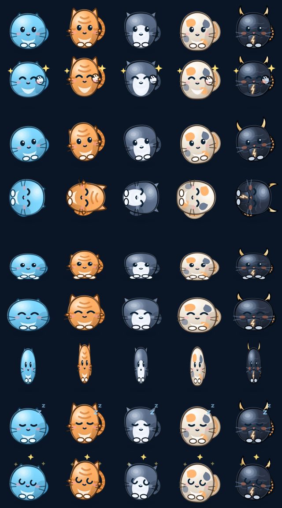

# 卓宠 · zhuochong

桌面宠物平台。宿主是一个 Tauri 2 小窗口，角色以**资源包插件**形式提供：一张 PNG 帧表 + 一份 `manifest.json`，不需要写代码就能做角色。



- 透明无边框置顶窗，拖动移动、位置记忆
- **5 只内置角色，五种体型**（不是同一只换色）：小卓圆胖短耳短尾 / 小橘瘦高大耳长尾带环纹 / 小煤肩宽方脸细长尾 / 三花蓬松折耳粗尾巴 / **焰甲机甲龙猫**（龙角、胸甲、熔岩能量纹、机械节段尾巴），右键切换
- **立体绘制**：径向受光 + 底部环境遮蔽 + 左上高光 + 底部反光 + 轮廓边缘光，落地投影随跳跃高度收缩变淡
- **互动**：单击随机动作（翻滚、跳跃、蠕动、爬行、挥手）、双击转圈圈、连点 4 下头晕、发呆自己玩、2 分钟不理它就睡觉、拎起来会挣扎
- 托盘菜单：显示/隐藏、打开插件目录、退出
- 插件零执行：宿主只读文件，不运行插件代码

## 快速开始

### 使用（普通用户）

从 [Releases](https://github.com/<owner>/zhuochong/releases) 下载对应平台安装包（Windows `.exe` / macOS `.dmg` / Linux `.AppImage`）。

安装后：左键拖动移动角色，单击互动，右键切换角色，托盘图标有菜单。

### 开发

前置：Node 20+、Rust 1.77+（[rustup](https://rustup.rs)）、Windows 需 WebView2（Win10/11 自带）。

```bash
npm install
npm run sprites     # 生成内置角色精灵图（已入库，改角色时才需要）
npm run tauri dev   # 启动宿主（首次编译较慢）
npm run tauri build # 产出安装包
```

### 自检

两个冒烟脚本，改完渲染或宿主代码后跑一遍：

```bash
npm run dev            # 另开一个终端
npm run verify:web     # 浏览器预览模式：精灵渲染、动画、互动、控制台无错
```

```bash
# 真实宿主内校验（含 Rust IPC）：需要先在 9222 上开 WebView2 调试端口
WEBVIEW2_ADDITIONAL_BROWSER_ARGUMENTS="--remote-debugging-port=9222" \
  cargo run --manifest-path src-tauri/Cargo.toml
npm run verify:app     # 插件扫描、精灵加载、窗口自适应、托盘提示
```

## 做自己的角色

1. 复制 `examples/hello-pet/`，改 `id` / `name`；
2. 准备一张 RGBA PNG 帧表（尺寸 = `cellWidth × columns` × `cellHeight × rows`）；
3. 在 `actions` 里定义 `idle`（必需）与可选动作；
4. 想要进阶互动就加 `behavior` 块（单击池、双击、连点、睡眠，见插件规范）；
5. 把整个文件夹放到插件目录，右键切换角色。

完整字段说明见 [docs/PLUGIN_SPEC.md](docs/PLUGIN_SPEC.md)。想改内置猫的配色或加新动作：

```bash
# 修改 scripts/gen-sprites.mjs 里的 PALETTES / ACTIONS 后重跑
npm run sprites
```

## 目录结构

```
src-tauri/            宿主（Rust）：窗口、托盘、插件扫描、配置读写
src/                  渲染层（TS + canvas）：帧动画、动作状态机
plugins/              内置插件 + 市场索引 index.json
examples/             插件模板
docs/                 插件规范与路线图
scripts/gen-sprites.mjs  用 SVG 生成帧表与应用图标
```

## 安全边界

v1 平台化刻意**不引入脚本插件**：

- 宿主只读 `manifest.json` 与 PNG，不执行任何插件代码；
- 精灵图文件名白名单校验，禁止 `../` 与绝对路径；
- 无网络、无文件系统访问的插件能力。

行为脚本与数据源联动在 v0.2 之后评估，需要配套沙箱与权限模型，见 [docs/ROADMAP.md](docs/ROADMAP.md)。

## 许可

- 代码：[MIT](LICENSE)
- 内置角色素材（`plugins/builtin-default/`）：CC0-1.0
- 第三方插件素材版权归各自作者，必须可再分发且不含他人 IP
