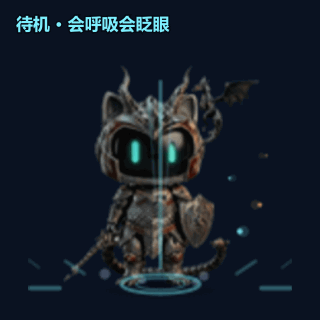

# 卓宠 · zhuochong

**一只住在桌面上的机甲猫骑士。** 透明置顶小窗 + 帧动画桌宠平台，角色以资源包插件形式提供——一张 PNG 帧表 + 一份 `manifest.json`，不用写代码就能做角色。

[](https://github.com/<owner>/zhuochong/releases)
[](https://github.com/<owner>/zhuochong/releases)
[](LICENSE)



## 下载使用（30 秒上手）

1. 到 [**Releases**](https://github.com/<owner>/zhuochong/releases) 下载最新绿色版 zip，解压即用（无需安装）
2. 双击 `zhuochong.exe`——龙焰喵出现在桌面上，置顶显示、不挡操作
3. 开始玩：

| 操作 | 效果 |
|---|---|
| **单击** | 随机动作：跳跃 / 挥剑 / 展翼蓄力 / 翻滚 / 转圈 / 挥手… |
| **双击** | 跃起放大招「跃焰斩」，窗口放大 + 系统通知播报 |
| **6 秒内连着双击** | 剑气逐级升温：青焰斩 → 霜雷斩 → **烈阳斩（全屏十字剑气）** |
| **按住拖动** | 被拎起来悬空挣扎，松手展翼落地 |
| **连点 4 下**（慢节奏） | 头晕冒星星 |
| **放着不动 2 分钟** | 睡觉打瞌睡，任意交互唤醒 |

> 首次运行若被 SmartScreen 拦截：点「更多信息 → 仍要运行」即可（绿色版未做代码签名）。

## 龙焰喵

AI 立绘 + 程序化动画的机甲猫骑士：黑色面罩、青焰竖瞳、盾刻龙纹、背负小龙与蝠翼。

- **19 个动作**：待机呼吸（会眨眼）、行走、小跑、挥剑（剑光弧+扬尘）、展翼蓄力（冲击环）、跳跃、翻滚、转圈、匍匐、坐地、挥手、扭动、睡觉（Zzz）、头晕、被拎起……以及三段大招
- **三段大招**：每段 8 帧完整编排（蓄力→腾空→空中举剑→劈落→裂地冲击→收势），剑气 / 冲击环 / 碎屑随等级换色，满级爆发全屏十字剑气
- **细节动效**：眼睛辉光呼吸、龙焰余烬、落地投影随高度收缩变淡、大招期间窗口按等级放大 1.3/1.55/1.8 倍
- 透明无边框置顶窗、位置记忆；托盘菜单：显示/隐藏、打开插件目录、退出
- **插件零执行**：宿主只读文件，不运行插件代码，无网络访问

## 做自己的角色

1. 复制 `examples/hello-pet/`，改 `id` / `name`；
2. 准备一张 RGBA PNG 帧表（尺寸 = `cellWidth × columns` × `cellHeight × rows`）；
3. 在 `manifest.json` 的 `actions` 里定义 `idle`（必需）与可选动作，进阶互动加 `behavior` 块；
4. 把整个文件夹放进插件目录即被扫描加载。

完整字段说明见 [docs/PLUGIN_SPEC.md](docs/PLUGIN_SPEC.md)。

## 给开发者

前置：Node 20+、Rust 1.77+（[rustup](https://rustup.rs)）、Windows 需 WebView2（Win10/11 自带）。

```bash
npm install
npm run tauri dev     # 启动宿主（首次编译较慢）
npm run tauri build   # 产出安装包
npm run dragon        # 重新生成龙焰喵精灵图与 manifest（改动作时才需要）
```

### 自检与素材脚本

```bash
npm run verify:web    # 浏览器预览模式冒烟（9 项）
npm run verify:app    # 真实宿主断言（23 项，需 9222 调试端口）
npm run verify:real   # 系统级真实鼠标注入校验（6 项）
npm run promo         # 录制 README 演示 GIF（docs/demo.gif）
```

`verify:app` / `verify:real` / `promo` 前先带调试端口启动宿主：

```bash
WEBVIEW2_ADDITIONAL_BROWSER_ARGUMENTS="--remote-debugging-port=9222" ./app/zhuochong.exe
```

## 目录结构

```
src-tauri/            宿主（Rust）：窗口、托盘、插件扫描、配置读写、缩放与通知
src/                  渲染层（TS + canvas）：帧动画、行为状态机、大招编排
plugins/              内置角色 dragon-flame + 市场索引 index.json
assets/dragon/        AI 生成的原始姿态图
scripts/gen-dragon.mjs  抠图、归一化、动作帧合成（含特效叠加）
scripts/gen-promo.mjs   宣传演示 GIF 录制
examples/             插件模板
docs/                 插件规范、路线图、发布清单
```

## 安全边界

- 宿主只读 `manifest.json` 与 PNG，不执行任何插件代码
- 精灵图文件名白名单校验，禁止 `../` 与绝对路径
- 无网络、无文件系统访问的插件能力

## 许可

- 代码：[MIT](LICENSE)
- 龙焰喵素材（`plugins/dragon-flame/`、`assets/dragon/`）：CC0-1.0
- 第三方插件素材版权归各自作者，必须可再分发且不含他人 IP
